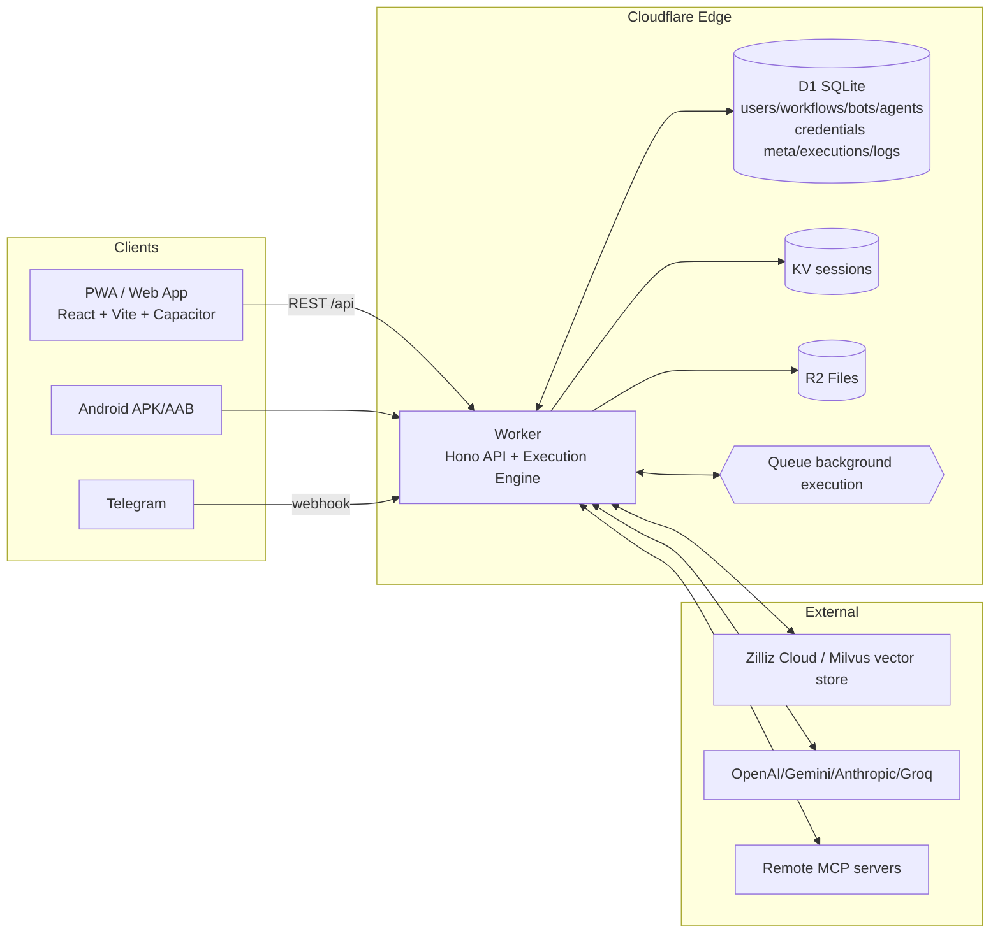

# FlowBot AI Studio

**Mobile-first AI automation and Telegram Bot builder** — a no-code node editor powered by Cloudflare Workers, D1, R2, Queues and Zilliz Cloud. Design automations on your phone with a full-screen canvas, deploy them to the edge, and connect them to Telegram and AI providers.

  

> **Developer:** Aung Myo Kyaw · **Brand:** AmkyawDev · **Email:** aung.thuyrain.at449@gmail.com · **Location:** Nay Pyi Taw, Myanmar · **TikTok:** https://www.tiktok.com/@amkyaw.dev1

---

## Table of contents

- [Features](#features)
- [Architecture](#architecture)
- [Screens](#screens)
- [Getting started (local)](#getting-started-local)
- [Cloudflare provisioning & deploy](#cloudflare-provisioning--deploy)
- [D1 migrations](#d1-migrations)
- [R2 & Queues setup](#r2--queues-setup)
- [Zilliz configuration](#zilliz-configuration)
- [Telegram setup](#telegram-setup)
- [PWA install](#pwa-install)
- [Android build & install](#android-build--install)
- [Security](#security)
- [Troubleshooting](#troubleshooting)
- [Download Android App](#download-android-app)
- [Environment variables](#environment-variables)
- [Admin information](#admin-information)

---

## Features

- **Node-based workflow editor** — mobile full-screen canvas with pinch zoom/pan, touch node drag, connect mode, node library drawer, configuration bottom sheet, undo/redo, and autosave with recovery.
- **15 built-in node types**, extensible through a plugin/adapter registry: Manual Trigger, Webhook Trigger, Telegram Trigger, Telegram Send Message, AI Agent, OpenAI-compatible Chat Completion, Google Gemini, HTTP Request, IF, Switch, Set/Transform, Delay, Zilliz Vector Search, Zilliz Vector Insert, and Error Handler.
- **Edge execution engine** — graph validation, topological ordering, per-node timeouts, bounded retries, error-handler routing, per-user isolation, execution records + logs, and background jobs via Cloudflare Queues.
- **Telegram Bot manager** — securely connect BotFather tokens, set webhooks with secret_token validation, start/help/custom commands, custom keyboards, per-bot AI prompt config, test messages and a message log.
- **AI Agent builder** — reusable agents with system prompts, provider/model selection, temperature, memory/tools and structured output (JSON schema).
- **Credential vault** — API keys and tokens encrypted with AES-256-GCM (Web Crypto); the master key is stored only as a Worker secret and secrets are never exposed to the browser.
- **Integrations** — OpenAI-compatible endpoints (OpenAI, Groq, OpenRouter), Anthropic, Gemini, generic HTTP/REST, and a **universal remote MCP connector** (Streamable HTTP) with dynamic tool discovery.
- **Installable PWA** + **Capacitor Android** packaging with reproducible GitHub Actions APK/AAB builds.
- **Cloudflare-native data** — D1 for relational/app data, R2 for files, Queues for background execution, Zilliz Cloud for vector search & long-term memory (configured via Worker secrets, degrades gracefully when absent).

## Architecture



The Worker owns all business logic. **No arbitrary `eval`/`Function`** runs on the edge — workflows are DAGs of typed, sandboxed node executors. User-provided code nodes are intentionally omitted from v1; a sandboxed code runner is on the roadmap.

## Screens

`Dashboard` · `Workflows` · `Workflow editor (canvas)` · `Bots` · `Integrations` · `AI Agents` · `Credentials` · `Executions` · `Settings`

Designed and tested for **320 / 360 / 390 / 412 px** mobile widths first, then tablet/desktop (sidebar + wider panels). Touch targets ≥ 44 px, dark nero + light-blue/cyan identity, glass surfaces, reduced-motion friendly. Real screenshots will be added once production hosting is live.

## Getting started (local)

Requires Node 20+.

```bash
# 1. Install all workspaces (shared, worker, web)
npm install

# 2. Run the Worker locally (miniflare). Create worker/.dev.vars with secrets:
#    CREDENTIAL_MASTER_KEY  (base64 32 bytes, e.g. `openssl rand -base64 32`)
#    AUTH_SESSION_SECRET    (e.g. `openssl rand -hex 32`)
#    ZILLIZ_ENDPOINT / ZILLIZ_TOKEN (optional)
npm run dev:worker          # http://localhost:8787

# 3. Seed local D1
cd worker && npx wrangler d1 migrations apply flowbot-db --local

# 4. Run the web app
npm run dev:web             # http://localhost:5173
```

The PWA builds a service worker for offline app-shell caching. See [PWA install](#pwa-install).

## Cloudflare provisioning & deploy

1. **Log in to Wrangler**:
   ```bash
   npx wrangler login
   ```
2. **Create resources** and paste the returned IDs into `worker/wrangler.toml` (replace the `REPLACE_WITH_*` placeholders):
   ```bash
   npx wrangler d1 create flowbot-db             # → database_id
   npx wrangler kv namespace create FLOWBOT_KV   # → id (+ preview_id)
   npx wrangler r2 bucket create flowbot-files
   ```
3. **Create the execution queue**:
   ```bash
   npx wrangler queues create flowbot-executions
   ```
4. **Set Worker secrets** (never commit these):
   ```bash
   cd worker
   echo "$CREDENTIAL_MASTER_KEY" | npx wrangler secret put CREDENTIAL_MASTER_KEY
   echo "$AUTH_SESSION_SECRET"   | npx wrangler secret put AUTH_SESSION_SECRET
   echo "$ZILLIZ_ENDPOINT"       | npx wrangler secret put ZILLIZ_ENDPOINT   # optional
   echo "$ZILLIZ_TOKEN"          | npx wrangler secret put ZILLIZ_TOKEN      # optional
   echo "$APP_BASE_URL"          | npx wrangler secret put APP_BASE_URL      # your public URL
   ```
5. **Apply migrations**:
   ```bash
   npx wrangler d1 migrations apply flowbot-db --remote
   ```
6. **Deploy**:
   ```bash
   npx wrangler deploy
   ```

The included [Deploy workflow](.github/workflows/deploy.yml) runs on `main` pushes when the standard GitHub secrets are configured:

| Secret | Purpose |
|---|---|
| `CLOUDFLARE_API_TOKEN` | Workers + D1 + KV + R2 + Queues edit |
| `CLOUDFLARE_ACCOUNT_ID` | Your Cloudflare account ID |
| `CREDENTIAL_MASTER_KEY` / `AUTH_SESSION_SECRET` | Vault + session secrets |
| `ZILLIZ_ENDPOINT` / `ZILLIZ_TOKEN` | Optional vector store |

## D1 migrations

Migrations live in `worker/migrations/` (`0001_init.sql`). They create:

- `users`, `sessions`, `workspaces`, `workspace_members`
- `workflows`, `workflow_versions` (graph snapshots)
- `bots`, `bot_messages`
- `credentials` (encrypted payloads + metadata), `integrations`, `agents`
- `executions`, `execution_logs`
- `settings`

**Passwords and raw API secrets are never stored in D1.** Passwords are PBKDF2-hashed with a per-user salt; API keys are AES-256-GCM ciphertext (master key in a Worker secret).

```bash
npx wrangler d1 migrations apply flowbot-db --local    # local dev
npx wrangler d1 migrations apply flowbot-db --remote   # production
```

## R2 & Queues setup

- **R2** — file storage (branding, uploads). `npx wrangler r2 bucket create flowbot-files`.
- **Queues** — background execution of long-running workflows so HTTP responses stay fast. The Producer (`EXECUTION_QUEUE`) enqueues `execute-workflow` messages; the consumer runs the graph with timeouts/retries and writes `executions` + `execution_logs`.

## Zilliz configuration

Zilliz Cloud (Milvus) powers **vector embeddings, semantic search, long-term memory and knowledge-base chunks**. It is a configurable endpoint, not a required credential:

- Set `ZILLIZ_ENDPOINT` and `ZILLIZ_TOKEN` as Cloudflare Worker secrets.
- The `Zilliz Vector Insert` node **auto-creates the collection** on first write (`flowbot_chunks` by default).
- When Zilliz secrets are absent, vector nodes **fail gracefully** with a clear "not configured" error — the rest of the workflow still runs.

The API contract (camelCase collection names) is verified against a live Zilliz Cloud in `worker/test/zilliz-live.test.ts`, covering list → create → describe → insert → search → drop. **The Zilliz token is only ever consumed from a Worker secret (env binding) — it is never committed and never exposed to the browser.**

## Telegram setup

1. Open Telegram → **@BotFather** → `/newbot` → name it → copy the token.
2. In FlowBot → **Bots** → **Add bot** → paste the token. The server verifies it with `getMe` (so the username already exists) and stores it encrypted.
3. Optionally configure **commands** (`/start`, `/help`, custom) and an **AI reply** agent.
4. In the workflow editor, add a **Telegram Trigger** (select the bot, optional `/command` filter) and **Telegram Send Message** nodes.
5. Click **Set webhook** to register `<APP_BASE_URL>/api/in/telegram/<secret>` with Telegram. The `secret_token` is validated on every update and tokens never leave the server.

Bot creation **must happen in Telegram via @BotFather** — FlowBot only manages the token afterwards.

## PWA install

- Open the deployed web app → browser *Add to Home screen* (Android Chrome / Edge, iOS Safari *Share → Add to Home Screen*).
- The service worker caches the app shell for offline use. **Backend workflow runs are never faked offline** — the UI shows when the API is unreachable and does not execute workflow nodes client-side.

## Android build & install

FlowBot uses **Capacitor** to package the PWA as a native Android app (Gradle project in `web/android/`).

### Local build (debug APK)

```bash
npm install
npm run build --workspace=flowbot-web
cd web/android
echo "sdk.dir=$ANDROID_HOME" > local.properties
./gradlew :app:assembleDebug --no-daemon
# APK: web/android/app/build/outputs/apk/debug/app-debug.apk
```

### GitHub Actions

- [`.github/workflows/ci.yml`](.github/workflows/ci.yml) — typecheck, tests, builds on every push/PR.
- [`.github/workflows/android.yml`](.github/workflows/android.yml) — debug APK on every push; signed release APK + AAB when signing secrets are configured.
- [`.github/workflows/release.yml`](.github/workflows/release.yml) — builds both and publishes a GitHub Release on `v*` tags.

Optional signing secrets (all four required, else release stays unsigned):

| Secret | Description |
|---|---|
| `AMKYAW_KEYSTORE_BASE64` | base64 of your `.jks` keystore |
| `AMKYAW_KEYSTORE_PASSWORD` | store & key password |
| `AMKYAW_KEY_ALIAS` | key alias |
| `AMKYAW_KEY_PASSWORD` | key password |

**Install:** allow *Unknown sources*, download the APK from [Releases](#download-android-app), and open it.

## Security

- Secrets encrypted with **AES-256-GCM**; master key is a Worker secret.
- **PBKDF2** password hashing with per-user salt; no passwords in D1.
- Telegram webhooks validated with **`secret_token`**; bot tokens never exposed to the browser.
- **No arbitrary `eval`/`Function`** on the edge — typed, sandboxed node executors.
- Execution runs **server-side**, never in the browser; per-user/workspace isolation on every query.
- All `/api/` traffic is network-only in the service worker.

## Troubleshooting

| Symptom | Fix |
|---|---|
| `Zilliz is not configured` | Set `ZILLIZ_ENDPOINT`/`ZILLIZ_TOKEN` as Worker secrets. |
| `Invalid Telegram bot token` | Paste the exact token from @BotFather (starts `123456789:…`). |
| Webhook returns 404 | Webhook URL must equal `<APP_BASE_URL>/api/in/telegram/<secret>`. |
| `Cannot find collection` | The insert node auto-creates it; match the vector dimension if manual. |
| D1 "unknown database" (local) | Run `npx wrangler d1 migrations apply flowbot-db --local`. |
| Android `sdk.dir` error | Set `local.properties` or open in Android Studio. |

## Download Android App

Pre-built artifacts publish to the **GitHub Releases** page:

- **Releases:** https://github.com/amkyawdev/flowbot-ai-studio/releases
- After a release build, `app-debug.apk` is always attached; signed `app-release.apk` / `app-release.aab` are attached when signing secrets are configured and the assets are verified.

> Download asset links are added to this README **only after assets are verified** on the Releases page.

## Environment variables

See [`.env.example`](.env.example) for the canonical list. Key variables:

| Variable | Scope | Notes |
|---|---|---|
| `CREDENTIAL_MASTER_KEY` | Worker secret | base64 32-byte key for the vault |
| `AUTH_SESSION_SECRET` | Worker secret | session signing key |
| `APP_BASE_URL` | Worker secret | public origin of the Worker |
| `CORS_ORIGINS` | Worker env | comma-separated allowed origins |
| `ZILLIZ_ENDPOINT`, `ZILLIZ_TOKEN`, `ZILLIZ_COLLECTION` | Worker secret | optional vector store |
| `VITE_API_BASE_URL` | web `.env` | backend URL during dev/build |

## Admin information

- **Developer:** Aung Myo Kyaw
- **Brand:** AmkyawDev
- **Email:** aung.thuyrain.at449@gmail.com
- **Location:** Nay Pyi Taw, Myanmar
- **TikTok:** https://www.tiktok.com/@amkyaw.dev1

---

© AmkyawDev. FlowBot AI Studio is an original product and does not reproduce third-party branding or assets.