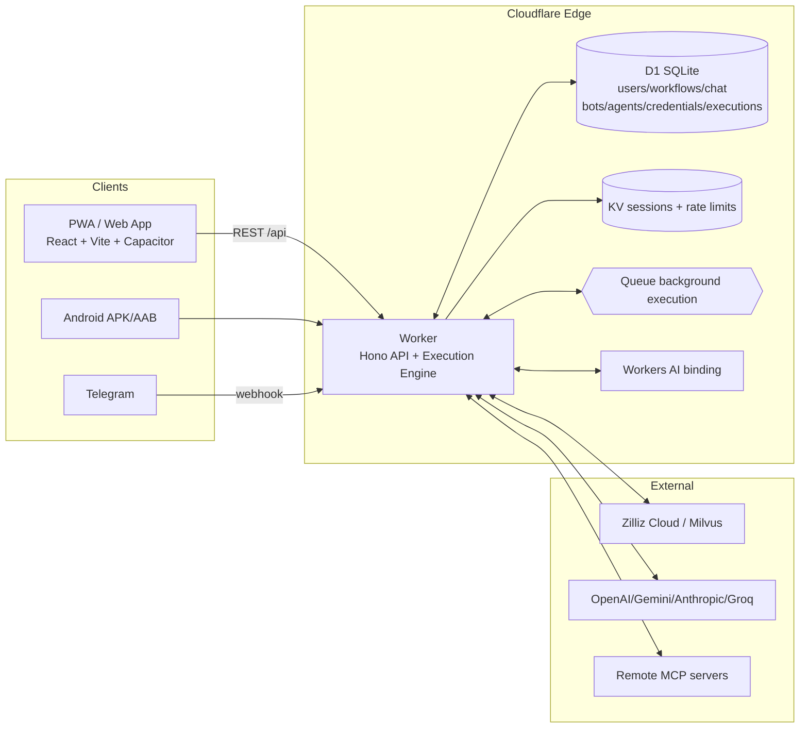

<p align="right"><b>English</b> · <a href="README.my.md">မြန်မာ</a></p>

# FlowBot AI Studio

**Mobile-first AI automation, chat, and Telegram Bot builder** — a no-code node editor plus an AI chat workspace, powered by Cloudflare Workers, D1, KV, Queues, Workers AI, and Zilliz Cloud.

   

> **Developer:** Aung Myo Kyaw · **Brand:** AmkyawDev · **Email:** aung.thuyrain.at449@gmail.com · **Location:** Nay Pyi Taw, Myanmar · **TikTok:** https://www.tiktok.com/@amkyaw.dev1

---

## Contents

- [What's new in v1.2.1](#whats-new-in-v121)
- [Features](#features)
- [Screens and routes](#screens-and-routes)
- [Architecture](#architecture)
- [Getting started (local)](#getting-started-local)
- [Environment variables](#environment-variables)
- [Cloudflare provisioning and deploy](#cloudflare-provisioning-and-deploy)
- [D1 migrations](#d1-migrations)
- [AI providers](#ai-providers)
- [Email code authentication](#email-code-authentication)
- [Cloudflare Workers AI](#cloudflare-workers-ai)
- [Zilliz configuration](#zilliz-configuration)
- [Chat and Public Chat](#chat-and-public-chat)
- [Telegram setup](#telegram-setup)
- [PWA install](#pwa-install)
- [Android build and install](#android-build-and-install)
- [Security](#security)
- [Troubleshooting](#troubleshooting)
- [Download Android App](#download-android-app)
- [Project structure](#project-structure)
- [Admin information](#admin-information)

---

## What's new in v1.2.1

- **AI Chat page** (`/chat`) with conversation history, search, rename, archive/delete, progressive text reveal, stop, regenerate, copy, system prompt, and provider/model selection.
- **Public Chat** (`/public-chat`) for all signed-in users, with an active-user avatar strip (left-to-right marquee), presence heartbeat, and **automatic 24-hour message cleanup**.
- **Email code authentication** — optional passwordless sign-in and registration verification with 6-digit email codes (Resend), hashed in D1 with 10-minute expiry and rate limits.
- **Animation Script System** — safe data-only presets (message entrance, typing, panel/sidebar transitions, presence marquee), preview/reset editor, and full `prefers-reduced-motion` support. No `eval`/`Function`.
- **Modern loading screen** with logo ring, grid, orbs, and progress bar.
- **Workflow builder upgrades** — run panel with input JSON, live logs and stop, import/export JSON, duplicate workflow, complete undo/redo, per-workflow autosave, searchable selectors, and validation.
- **Cloudflare Workers AI** via the server-side `env.AI` binding and a `cloudflareAI` node.
- **Zilliz hardening** — endpoint normalization, camelCase `dbName`, `ZILLIZ_URL`/`ZILLIZ_TOKEN` aliases, and runtime status/test endpoints.
- **Security** — CORS allowlist, CSP and security headers, login throttling, execution-log redaction, workspace-scoped version history.

## Features

- **Node-based workflow editor** — full-screen canvas, pinch zoom/pan, touch drag, animated connections, node library with quick add / recently used / categories / search, configuration sheet with validation, undo/redo, import/export, and autosave with recovery.
- **16 built-in node types** — Manual Trigger, Webhook Trigger, Telegram Trigger, Telegram Send Message, AI Agent, OpenAI-compatible Chat, Google Gemini, **Cloudflare Workers AI**, HTTP Request, IF, Switch, Set/Transform, Delay, Zilliz Vector Search, Zilliz Vector Insert, and Error Handler.
- **Edge execution engine** — graph validation, topological ordering, per-node timeouts, bounded retries, error-handler routing, per-workspace isolation, execution records and logs, and background jobs via Cloudflare Queues.
- **AI Chat workspace** — persistent conversations, provider/model selection, system prompts, streaming-style reveal, regenerate, and error recovery.
- **Public Chat room** — presence avatars, shared messages, rate limiting, and 24-hour retention.
- **Telegram Bot manager** — BotFather tokens stored encrypted, webhook registration with `secret_token`, commands, keyboards, per-bot AI replies, test messages, and a message log.
- **AI Agent builder** — reusable agents with system prompt, provider/model, temperature, tools, and structured output (JSON schema).
- **Credential vault** — API keys and tokens encrypted with AES-256-GCM (Web Crypto); the master key is a Worker secret and secrets never reach the browser.
- **Integrations** — OpenAI-compatible endpoints (OpenAI, Groq, OpenRouter, custom), Anthropic, Gemini, Cloudflare Workers AI, generic HTTP/REST, and a remote MCP connector.
- **Installable PWA** and **Capacitor Android** packaging with GitHub Actions APK/AAB builds.
- **Cloudflare-native data** — D1 for relational data, KV for sessions/rate limits, Queues for background execution, Workers AI for edge inference, and Zilliz Cloud for vector search. R2 is optional and not enabled in the default deployment.

## Screens and routes

| Route | Screen |
|---|---|
| `/` | Dashboard |
| `/workflows` | Workflow list (card grid, search, run/duplicate/delete) |
| `/workflows/:id` | Workflow editor (canvas, node library, config sheet, run panel) |
| `/chat` | AI Chat workspace |
| `/public-chat` | Public Chat room |
| `/bots` | Telegram bots |
| `/integrations` | Integrations (MCP, Zilliz) |
| `/agents` | AI Agents |
| `/credentials` | Credential vault |
| `/executions` | Execution history and logs |
| `/settings` | Account, Zilliz status/test, runtime flags, about |

Designed mobile-first (320 / 360 / 390 / 412 px), then tablet and desktop (sidebar + wider panels). Touch targets ≥ 44 px, dark nero + cyan identity, glass surfaces, reduced-motion friendly.

## Architecture



The Worker owns all business logic. **No arbitrary `eval`/`Function`** runs on the edge — workflows are DAGs of typed, sandboxed node executors.

## Getting started (local)

Requires Node 20+.

```bash
# 1. Install all workspaces (shared, worker, web)
npm install

# 2. Create worker/.dev.vars (never commit it)
#    CREDENTIAL_MASTER_KEY  (openssl rand -base64 32)
#    AUTH_SESSION_SECRET    (openssl rand -hex 32)
#    ZILLIZ_ENDPOINT / ZILLIZ_API_KEY (optional, server-side only)
npm run dev:worker          # http://localhost:8787

# 3. Apply local D1 migrations
cd worker && npx wrangler d1 migrations apply flowbot-db --local

# 4. Run the web app
npm run dev:web             # http://localhost:5173
```

> Build order matters: the Worker serves `web/dist`, so build the web workspace first (`npm run build --workspace=flowbot-web`) before the Worker.

## Environment variables

See [`.env.example`](.env.example) for the canonical list.

| Variable | Scope | Notes |
|---|---|---|
| `CREDENTIAL_MASTER_KEY` | Worker secret | base64 32-byte key for the AES-256-GCM vault |
| `AUTH_SESSION_SECRET` | Worker secret | session signing key |
| `APP_BASE_URL` | Worker var/secret | public origin of the Worker |
| `CORS_ORIGINS` | Worker env | comma-separated allowed origins (an allowlist is built in) |
| `ZILLIZ_ENDPOINT` / `ZILLIZ_URL` | Worker var/secret | Zilliz REST base URL (server-side only) |
| `ZILLIZ_API_KEY` / `ZILLIZ_TOKEN` | Worker secret | Zilliz API key (never exposed) |
| `ZILLIZ_COLLECTION` | Worker env | optional collection name (default `flowbot_chunks`) |
| `TELEGRAM_API_URL` | Worker env | optional Telegram API base URL |
| `VITE_API_BASE_URL` | web `.env` | backend URL during dev/build |
| `RESEND_API_KEY` / `EMAIL_FROM` | Worker secret | email OTP delivery (Resend) |
| `AUTH_OTP_MODE` | Worker var | `optional` / `required` / `off` |
| `OTP_DEV_ECHO` | dev only | echo OTP locally (never production) |

## Cloudflare provisioning and deploy

1. **Log in to Wrangler**:
   ```bash
   npx wrangler login
   ```
2. **Create resources** and paste the returned IDs into `worker/wrangler.toml`:
   ```bash
   npx wrangler d1 create flowbot-db
   npx wrangler kv namespace create FLOWBOT_KV
   npx wrangler queues create flowbot-executions
   ```
3. **Set Worker secrets**:
   ```bash
   cd worker
   printf '%s' "$CREDENTIAL_MASTER_KEY" | npx wrangler secret put CREDENTIAL_MASTER_KEY
   printf '%s' "$AUTH_SESSION_SECRET"   | npx wrangler secret put AUTH_SESSION_SECRET
   printf '%s' "$ZILLIZ_ENDPOINT"       | npx wrangler secret put ZILLIZ_ENDPOINT   # optional
   printf '%s' "$ZILLIZ_API_KEY"        | npx wrangler secret put ZILLIZ_API_KEY    # optional
   ```
4. **Apply migrations and deploy**:
   ```bash
   npx wrangler d1 migrations apply flowbot-db --remote
   npx wrangler deploy
   ```

The [Deploy workflow](.github/workflows/deploy.yml) runs on `main` pushes and on manual dispatch. It builds the web app, deploys the Worker, applies D1 migrations, and sets Worker secrets.

| GitHub setting | Kind | Purpose |
|---|---|---|
| `CLOUDFLARE_API_KEY` | secret | Cloudflare Global API Key used by Wrangler |
| `CLOUDFLARE_EMAIL` | variable | Cloudflare account email |
| `CLOUDFLARE_ACCOUNT_ID` | secret or variable | Cloudflare account ID |
| `CREDENTIAL_MASTER_KEY` / `AUTH_SESSION_SECRET` | secret | vault + session secrets |
| `ZILLIZ_ENDPOINT` / `ZILLIZ_API_KEY` | secret | optional vector store |
| `RESEND_API_KEY` / `EMAIL_FROM` | secret | optional email OTP delivery |

## D1 migrations

Migrations live in `worker/migrations/`:

- `0001_init.sql` — users, sessions, workspaces, workflows, bots, credentials, integrations, agents, executions, logs, settings.
- `0002_agent_endpoint.sql` — per-agent custom endpoint and credential link.
- `0003_chat.sql` — `conversations`, `chat_messages`, `public_messages`, `public_presence`.
- `0004_email_otp.sql` — `users.email_verified` and the `email_otps` table.

**Passwords and raw API secrets are never stored in D1.** Passwords are PBKDF2-hashed with a per-user salt; API keys are AES-256-GCM ciphertext (master key in a Worker secret).

```bash
npx wrangler d1 migrations apply flowbot-db --local    # local
npx wrangler d1 migrations apply flowbot-db --remote   # production
```

## AI providers

Provider adapters live in `worker/src/integrations/providers.ts` and support:

- **OpenAI** (`https://api.openai.com/v1`)
- **Groq** (`https://api.groq.com/openai/v1`)
- **OpenRouter** (`https://openrouter.ai/api/v1`)
- **Custom OpenAI-compatible** (requires a Base URL)
- **Google Gemini**
- **Anthropic**
- **Cloudflare Workers AI**

Credentials are created in **Credentials** with API key, optional Base URL, optional custom headers (stored encrypted), and an optional default model. Connection tests run server-side and never return secrets. Node configs can override the Base URL and choose a provider/model with searchable selectors.

## Email code authentication

FlowBot can verify registration and offer passwordless sign-in with a 6-digit email code.

1. Create a [Resend](https://resend.com) account and verify your sending domain.
2. Set Worker secrets `RESEND_API_KEY` and `EMAIL_FROM` (for example `FlowBot <no-reply@yourdomain.com>`).
3. Optionally set `AUTH_OTP_MODE`: `optional` (default — email-code sign-in is offered), `required` (a code is required after the password), or `off`.
4. Deploy. The login page shows **Sign in with an email code**; registration sends a verification code.

Codes are stored only as SHA-256 hashes in D1, expire after 10 minutes, allow 5 attempts, and are rate-limited to one request per email per minute. For local testing only, set `OTP_DEV_ECHO=true` in `worker/.dev.vars` to display the code in the UI — never enable it in production.

## Cloudflare Workers AI

Workers AI runs entirely server-side through the `env.AI` binding — no API key is stored or sent to the browser.

```toml
# worker/wrangler.toml
[ai]
binding = "AI"
```

Use the **Cloudflare Workers AI** node (or select `cloudflare` in Chat/Agents) and choose a `@cf/...` model. If the binding is unavailable, the UI reports it clearly instead of failing silently.

## Zilliz configuration

Zilliz Cloud (Milvus) powers vector search and knowledge chunks.

- `ZILLIZ_ENDPOINT` (alias `ZILLIZ_URL`) — REST base URL, e.g. `https://in03-…cloud.zilliz.com` (no `/v2/...` path).
- `ZILLIZ_API_KEY` (alias `ZILLIZ_TOKEN`) — API key, stored as a Worker secret.
- `ZILLIZ_COLLECTION` — optional collection name (default `flowbot_chunks`).

The Worker normalizes the endpoint, accepts camelCase/snake_case collection names, and uses `dbName` in REST payloads. The insert node auto-creates the collection on first write. When unconfigured, vector nodes fail gracefully with a clear message.

Verify at **Settings → Zilliz vector store → Test connection**, or call `GET /api/zilliz/status` / `POST /api/zilliz/test`. Live coverage: `worker/test/zilliz-live.test.ts` (list → create → describe → insert → search → drop). Config coverage: `worker/test/zilliz-config.test.ts` and `worker/test/zilliz-utils.test.ts`.

## Chat and Public Chat

- **AI Chat** (`/chat`) stores conversations and messages in D1. Replies are revealed progressively in the browser; **Stop** aborts the request/reveal, and **Regenerate** replaces the last assistant reply. Provider, model, credential, and system prompt are configurable per session.
- **Public Chat** (`/public-chat`) is available to signed-in users. It shows active-user avatars above the message body with a left-to-right marquee, a presence heartbeat, and server-side rate limiting. Each user gets one of **30 SVG avatars (15 male / 15 female)** shown at 30px. Messages are **deleted automatically after 24 hours** (lazy cleanup on read/post plus an hourly cron).
- Both pages respect the system `prefers-reduced-motion` setting.

## Telegram setup

1. Open Telegram → **@BotFather** → `/newbot` → copy the token.
2. In FlowBot → **Bots** → **Add bot** → paste the token. The server verifies it with `getMe` and stores it encrypted.
3. Optionally configure commands and an AI reply agent.
4. In the editor, add a **Telegram Trigger** and **Telegram Send Message** node.
5. Click **Set webhook** to register `<APP_BASE_URL>/api/in/telegram/<secret>`. The `secret_token` is validated on every update.

## PWA install

Open the deployed app → *Add to Home screen* (Android Chrome/Edge, iOS Safari *Share → Add to Home Screen*). The service worker caches the app shell for offline use; backend workflow runs are never faked offline.

## Android build and install

FlowBot uses **Capacitor** (Gradle project in `web/android/`).

```bash
npm install
npm run build --workspace=flowbot-web
cd web/android
echo "sdk.dir=$ANDROID_HOME" > local.properties
./gradlew :app:assembleDebug --no-daemon
# APK: web/android/app/build/outputs/apk/debug/app-debug.apk
```

GitHub Actions:

- [`ci.yml`](.github/workflows/ci.yml) — typecheck, tests, builds.
- [`android.yml`](.github/workflows/android.yml) — debug APK on push; signed release APK + AAB when signing secrets exist.
- [`release.yml`](.github/workflows/release.yml) — publishes a GitHub Release on `v*` tags.

Optional signing secrets: `AMKYAW_KEYSTORE_BASE64`, `AMKYAW_KEYSTORE_PASSWORD`, `AMKYAW_KEY_ALIAS`, `AMKYAW_KEY_PASSWORD`.

**Install:** allow *Unknown sources*, download the APK from [Releases](#download-android-app), and open it.

## Security

- AES-256-GCM encryption for secrets; master key is a Worker secret.
- PBKDF2 password hashing with per-user salt; no passwords in D1.
- Email OTP codes are SHA-256 hashed, expire in 10 minutes, allow 5 attempts, and are rate-limited.
- Telegram webhooks validated with `secret_token`; bot tokens never exposed.
- CORS allowlist, CSP, `X-Content-Type-Options`, `X-Frame-Options`, `Referrer-Policy`, `Permissions-Policy`, and HSTS.
- Login throttling (KV-based) and timing-safe hash comparison.
- Execution logs redact secret-like keys and truncate long values.
- No arbitrary `eval`/`Function` on the edge; workflow execution is server-side with per-workspace isolation.
- All `/api/` traffic is network-only in the service worker.

## Troubleshooting

| Symptom | Fix |
|---|---|
| `Zilliz is not configured` | Set `ZILLIZ_ENDPOINT` + `ZILLIZ_API_KEY` (or `ZILLIZ_URL` + `ZILLIZ_TOKEN`). |
| Zilliz test fails with 401 | Check the API key and that the endpoint is the base URL, not a `/v2/...` path. |
| Public Chat 500 | Ensure migration `0003_chat.sql` is applied and the Worker is redeployed. |
| `Invalid Telegram bot token` | Paste the exact token from @BotFather. |
| Webhook 404 | URL must equal `<APP_BASE_URL>/api/in/telegram/<secret>`. |
| D1 "unknown database" (local) | Run `npx wrangler d1 migrations apply flowbot-db --local`. |
| Android `sdk.dir` error | Set `local.properties` or open in Android Studio. |

## Download Android App

Pre-built artifacts publish to the **GitHub Releases** page.

**Latest release — [v1.2.1](https://github.com/amkyawdev/flowbot-ai-studio/releases/tag/v1.2.1):**

| Asset | Description | Link |
|---|---|---|
| `app-debug.apk` | Debug build (1.2.1) — installable on any Android device | [Download APK](https://github.com/amkyawdev/flowbot-ai-studio/releases/download/v1.2.1/app-debug.apk) |
| `app-release.aab` | Release Android App Bundle (unsigned unless signing secrets are set) | [Download AAB](https://github.com/amkyawdev/flowbot-ai-studio/releases/download/v1.2.1/app-release.aab) |

The debug APK is signed with Android's debug key, so it installs with *Unknown sources* enabled.

## Project structure

```
shared/          Node definitions, graph validation, template helpers
worker/          Cloudflare Worker (Hono), D1/KV/Queues/Workers AI, execution engine
  migrations/    0001_init.sql, 0002_agent_endpoint.sql, 0003_chat.sql, 0004_email_otp.sql
  src/routes/    auth, workflows, executions, bots, credentials, integrations, agents, settings, chat
  src/engine/    runner, executors, vault
  src/integrations/ providers, zilliz, telegram, mcp, http, email
  src/otp.ts     email OTP generation/hash helpers
web/             React + Vite PWA (Capacitor Android in web/android)
  src/pages/     Dashboard, Workflows, WorkflowEditor, Chat, Bots, Integrations, Agents, Credentials, Executions, Settings
  src/editor/    NodeCard, NodeLibrary, NodeConfigSheet
  src/store/     app, workflow, chat
  src/lib/       animations, node tests
```

## Admin information

- **Developer:** Aung Myo Kyaw
- **Brand:** AmkyawDev
- **Email:** aung.thuyrain.at449@gmail.com
- **Location:** Nay Pyi Taw, Myanmar
- **TikTok:** https://www.tiktok.com/@amkyaw.dev1
