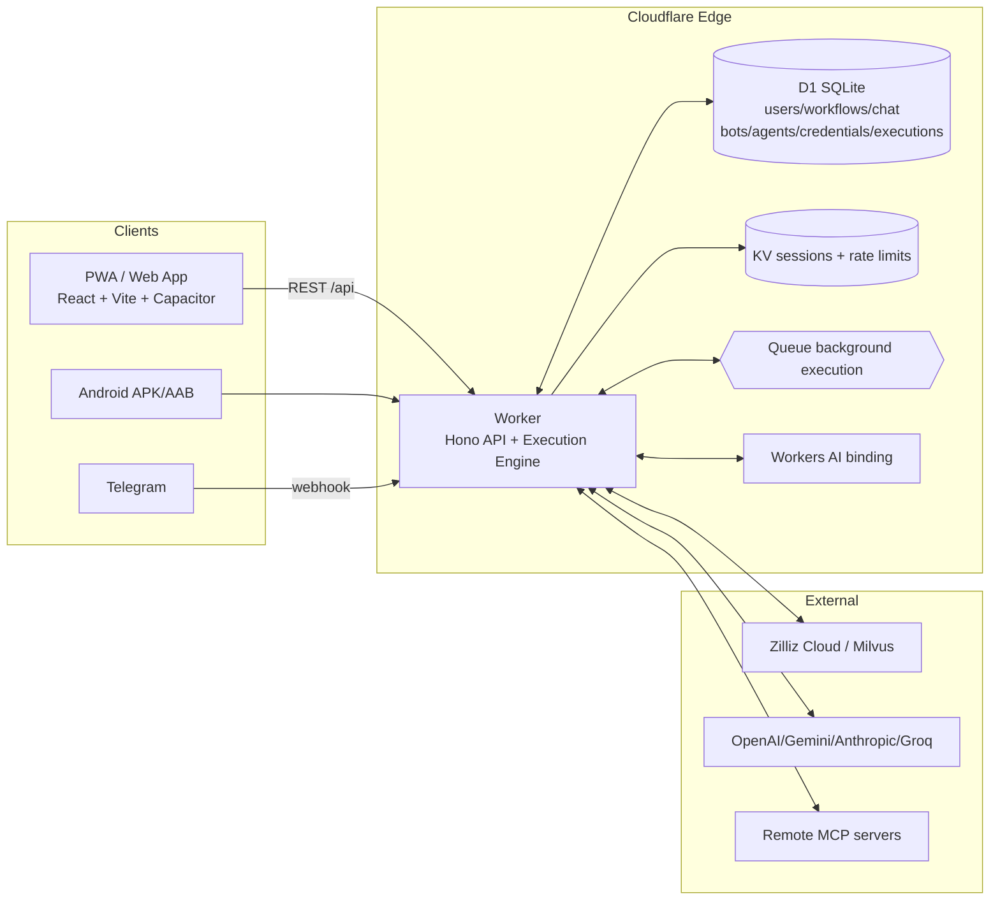

<p align="right"><a href="README.md">English</a> · <b>မြန်မာ</b></p>

# FlowBot AI Studio

**Mobile-first AI automation, chat နှင့် Telegram Bot builder** — Cloudflare Workers, D1, KV, Queues, Workers AI နှင့် Zilliz Cloud ဖြင့် မောင်းနှင်သော no-code node editor နှင့် AI chat workspace။

   

> **Developer:** Aung Myo Kyaw · **Brand:** AmkyawDev · **Email:** aung.thuyrain.at449@gmail.com · **Location:** Nay Pyi Taw, Myanmar · **TikTok:** https://www.tiktok.com/@amkyaw.dev1

---

## မာတိကာ

- [v1.2.3 တွင် အသစ်များ](#v121-တွင်-အသစ်များ)
- [အင်္ဂါရပ်များ](#အင်္ဂါရပ်များ)
- [စာမျက်နှာများနှင့် route များ](#စာမျက်နှာများနှင့်-route-များ)
- [Architecture](#architecture)
- [Local တွင် စတင်အသုံးပြုခြင်း](#local-တွင်-စတင်အသုံးပြုခြင်း)
- [Environment variables](#environment-variables)
- [Cloudflare ပြင်ဆင်ခြင်းနှင့် deploy](#cloudflare-ပြင်ဆင်ခြင်းနှင့်-deploy)
- [D1 migrations](#d1-migrations)
- [AI providers](#ai-providers)
- [Email code authentication](#email-code-authentication)
- [Cloudflare Workers AI](#cloudflare-workers-ai)
- [Zilliz ပြင်ဆင်ခြင်း](#zilliz-ပြင်ဆင်ခြင်း)
- [Chat နှင့် Public Chat](#chat-နှင့်-public-chat)
- [Telegram ပြင်ဆင်ခြင်း](#telegram-ပြင်ဆင်ခြင်း)
- [PWA install](#pwa-install)
- [Android build နှင့် install](#android-build-နှင့်-install)
- [Security](#security)
- [ပြဿနာဖြေရှင်းခြင်း](#ပြဿနာဖြေရှင်းခြင်း)
- [Android App ဒေါင်းလုဒ်](#android-app-ဒေါင်းလုဒ်)
- [Project structure](#project-structure)
- [Admin အချက်အလက်](#admin-အချက်အလက်)

---

## v1.2.3 တွင် အသစ်များ

- **Workflow editor fix** — node name/icon မှန် (Manual Trigger, Set, Delay, …)၊ dark readable card နှင့် animated edge မြင်နိုင်။
- **PWA auto-update** — deploy အသစ်များ ချက်ချင်း အသက်ဝင်ပြီး အဟောင်း cache မပြ။
- **Verified** — end-to-end workflow run (Manual Trigger → Set → Delay → Set) success ဖြစ်ပြီး node တစ်ခုချင်း log ထွက်။
- **Register page download** — “Download App” button နှင့် APK URL တိုက်ရိုက်။
- **Fixes** — Public Chat 500 (KV TTL) နှင့် README နှစ်ဘာသာ (English / မြန်မာ)။
- **AI Chat page** (`/chat`) — conversation history, search, rename, archive/delete, progressive text reveal, stop, regenerate, copy, system prompt နှင့် provider/model ရွေးချယ်မှု။
- **Public Chat** (`/public-chat`) — signed-in user အားလုံးအတွက်၊ active-user avatar strip (left-to-right marquee), presence heartbeat နှင့် **24 နာရီအလိုက် အလိုအလျောက် message ဖျက်ခြင်း**။
- **Email code authentication** — 6-digit email code ဖြင့် passwordless sign-in နှင့် registration verification (Resend)၊ D1 တွင် hash သိမ်း၊ 10 မိနစ် expiry နှင့် rate limit။
- **Animation Script System** — data-only safe presets (message entrance, typing, panel/sidebar transition, presence marquee), preview/reset editor နှင့် `prefers-reduced-motion` အပြည့်အဝပံ့ပိုးမှု။ `eval`/`Function` မသုံးပါ။
- **Modern loading screen** — logo ring, grid, orbs နှင့် progress bar။
- **Workflow builder တိုးတက်မှုများ** — input JSON ပါသော run panel, live logs နှင့် stop, import/export JSON, workflow duplicate, undo/redo အပြည့်အစုံ, per-workflow autosave, searchable selector နှင့် validation။
- **Cloudflare Workers AI** — server-side `env.AI` binding နှင့် `cloudflareAI` node။
- **Zilliz ပိုမိုခိုင်မာမှု** — endpoint normalization, camelCase `dbName`, `ZILLIZ_URL`/`ZILLIZ_TOKEN` alias နှင့် runtime status/test endpoint များ။
- **Security** — CORS allowlist, CSP နှင့် security headers, login throttling, execution-log redaction, workspace-scoped version history။

## အင်္ဂါရပ်များ

- **Node-based workflow editor** — full-screen canvas, pinch zoom/pan, touch drag, animated connection, node library (quick add / recently used / categories / search), validation ပါသော configuration sheet, undo/redo, import/export နှင့် autosave recovery။
- **Built-in node ၁၆ မျိုး** — Manual Trigger, Webhook Trigger, Telegram Trigger, Telegram Send Message, AI Agent, OpenAI-compatible Chat, Google Gemini, **Cloudflare Workers AI**, HTTP Request, IF, Switch, Set/Transform, Delay, Zilliz Vector Search, Zilliz Vector Insert နှင့် Error Handler။
- **Edge execution engine** — graph validation, topological ordering, per-node timeout, bounded retry, error-handler routing, per-workspace isolation, execution record/log နှင့် Cloudflare Queues ဖြင့် background job။
- **AI Chat workspace** — conversation များ သိမ်းဆည်းခြင်း, provider/model ရွေးချယ်ခြင်း, system prompt, streaming-style reveal, regenerate နှင့် error recovery။
- **Public Chat room** — presence avatar, shared message, rate limit နှင့် 24 နာရီ retention။
- **Telegram Bot manager** — BotFather token ကို encrypt လုပ်သိမ်းခြင်း, `secret_token` ဖြင့် webhook, command, keyboard, per-bot AI reply, test message နှင့် message log။
- **AI Agent builder** — system prompt, provider/model, temperature, tools နှင့် structured output (JSON schema) ပါသော reusable agent။
- **Credential vault** — API key/token များကို AES-256-GCM (Web Crypto) ဖြင့် encrypt; master key ကို Worker secret အဖြစ်သာ ထားပြီး browser သို့ မပေးပါ။
- **Integrations** — OpenAI-compatible (OpenAI, Groq, OpenRouter, custom), Anthropic, Gemini, Cloudflare Workers AI, generic HTTP/REST နှင့် remote MCP connector။
- **Installable PWA** နှင့် **Capacitor Android** — GitHub Actions ဖြင့် APK/AAB build။
- **Cloudflare-native data** — D1 (relational), KV (session/rate limit), Queues (background), Workers AI (edge inference), Zilliz Cloud (vector search)။ R2 သည် optional ဖြစ်ပြီး default deployment တွင် မဖွင့်ထားပါ။

## စာမျက်နှာများနှင့် route များ

| Route | စာမျက်နှာ |
|---|---|
| `/` | Dashboard |
| `/workflows` | Workflow list (card grid, search, run/duplicate/delete) |
| `/workflows/:id` | Workflow editor (canvas, node library, config sheet, run panel) |
| `/chat` | AI Chat workspace |
| `/public-chat` | Public Chat room |
| `/bots` | Telegram bots |
| `/integrations` | Integrations (MCP, Zilliz) |
| `/agents` | AI Agents |
| `/credentials` | Credential vault |
| `/executions` | Execution history နှင့် logs |
| `/settings` | Account, Zilliz status/test, runtime flags, about |

Mobile-first (320 / 360 / 390 / 412 px) အတွက် ဒီဇိုင်းထုတ်ပြီး tablet/desktop တွင် sidebar + wider panel ဖြင့် ပြပါသည်။ Touch target ≥ 44 px, dark nero + cyan အပြင်အဆင်, glass surface နှင့် reduced-motion friendly။

## Architecture



Business logic အားလုံးကို Worker က ပိုင်ဆိုင်ပါသည်။ Edge တွင် **arbitrary `eval`/`Function` မရှိပါ** — workflow များသည် typed, sandboxed node executor များ၏ DAG ဖြစ်သည်။

## Local တွင် စတင်အသုံးပြုခြင်း

Node 20+ လိုအပ်ပါသည်။

```bash
# 1. workspace အားလုံး install
npm install

# 2. worker/.dev.vars ဖန်တီးပါ (commit မလုပ်ပါနှင့်)
#    CREDENTIAL_MASTER_KEY  (openssl rand -base64 32)
#    AUTH_SESSION_SECRET    (openssl rand -hex 32)
#    ZILLIZ_ENDPOINT / ZILLIZ_API_KEY (optional, server-side only)
npm run dev:worker          # http://localhost:8787

# 3. local D1 migration
cd worker && npx wrangler d1 migrations apply flowbot-db --local

# 4. web app run
npm run dev:web             # http://localhost:5173
```

> Build အစီအစဉ် အရေးကြီးပါသည် — Worker က `web/dist` ကို serve လုပ်သောကြောင့် web ကို အရင် build လုပ်ပါ (`npm run build --workspace=flowbot-web`)။

## Environment variables

အပြည့်အစုံကို [`.env.example`](.env.example) တွင် ကြည့်ပါ။

| Variable | Scope | မှတ်ချက် |
|---|---|---|
| `CREDENTIAL_MASTER_KEY` | Worker secret | AES-256-GCM vault အတွက် base64 32-byte key |
| `AUTH_SESSION_SECRET` | Worker secret | session signing key |
| `APP_BASE_URL` | Worker var/secret | Worker ၏ public origin |
| `CORS_ORIGINS` | Worker env | ခွင့်ပြုထားသော origin များ (comma-separated) |
| `ZILLIZ_ENDPOINT` / `ZILLIZ_URL` | Worker var/secret | Zilliz REST base URL (server-side only) |
| `ZILLIZ_API_KEY` / `ZILLIZ_TOKEN` | Worker secret | Zilliz API key (browser သို့ မပေး) |
| `ZILLIZ_COLLECTION` | Worker env | optional collection (default `flowbot_chunks`) |
| `TELEGRAM_API_URL` | Worker env | optional Telegram API base URL |
| `VITE_API_BASE_URL` | web `.env` | dev/build တွင် backend URL |
| `RESEND_API_KEY` / `EMAIL_FROM` | Worker secret | email OTP delivery (Resend) |
| `AUTH_OTP_MODE` | Worker var | `optional` / `required` / `off` |
| `OTP_DEV_ECHO` | dev only | local တွင် OTP ပြ (production မထည့်ရ) |

## Cloudflare ပြင်ဆင်ခြင်းနှင့် deploy

1. **Wrangler login**:
   ```bash
   npx wrangler login
   ```
2. **Resource များ ဖန်တီးပြီး** ရလာသော ID များကို `worker/wrangler.toml` တွင် ထည့်ပါ:
   ```bash
   npx wrangler d1 create flowbot-db
   npx wrangler kv namespace create FLOWBOT_KV
   npx wrangler queues create flowbot-executions
   ```
3. **Worker secret များ သတ်မှတ်ပါ**:
   ```bash
   cd worker
   printf '%s' "$CREDENTIAL_MASTER_KEY" | npx wrangler secret put CREDENTIAL_MASTER_KEY
   printf '%s' "$AUTH_SESSION_SECRET"   | npx wrangler secret put AUTH_SESSION_SECRET
   printf '%s' "$ZILLIZ_ENDPOINT"       | npx wrangler secret put ZILLIZ_ENDPOINT   # optional
   printf '%s' "$ZILLIZ_API_KEY"        | npx wrangler secret put ZILLIZ_API_KEY    # optional
   ```
4. **Migration apply ပြီး deploy**:
   ```bash
   npx wrangler d1 migrations apply flowbot-db --remote
   npx wrangler deploy
   ```

[Deploy workflow](.github/workflows/deploy.yml) သည် `main` push သို့မဟုတ် manual dispatch တွင် run ပြီး web build, Worker deploy, D1 migration နှင့် Worker secret သတ်မှတ်ခြင်းတို့ကို လုပ်ဆောင်ပါသည်။

| GitHub setting | Kind | ရည်ရွယ်ချက် |
|---|---|---|
| `CLOUDFLARE_API_KEY` | secret | Wrangler အတွက် Cloudflare Global API Key |
| `CLOUDFLARE_EMAIL` | variable | Cloudflare account email |
| `CLOUDFLARE_ACCOUNT_ID` | secret/variable | Cloudflare account ID |
| `CREDENTIAL_MASTER_KEY` / `AUTH_SESSION_SECRET` | secret | vault + session secret |
| `ZILLIZ_ENDPOINT` / `ZILLIZ_API_KEY` | secret | optional vector store |
| `RESEND_API_KEY` / `EMAIL_FROM` | secret | optional email OTP delivery |

## D1 migrations

`worker/migrations/` တွင် ရှိပါသည်:

- `0001_init.sql` — users, sessions, workspaces, workflows, bots, credentials, integrations, agents, executions, logs, settings။
- `0002_agent_endpoint.sql` — agent တစ်ခုချင်းအတွက် custom endpoint နှင့် credential link။
- `0003_chat.sql` — `conversations`, `chat_messages`, `public_messages`, `public_presence`။
- `0004_email_otp.sql` — `users.email_verified` နှင့် `email_otps` table။

**Password နှင့် raw API secret များကို D1 တွင် မသိမ်းပါ။** Password များကို per-user salt ဖြင့် PBKDF2 hash လုပ်ပြီး API key များကို AES-256-GCM ciphertext အဖြစ် သိမ်းသည် (master key သည် Worker secret)။

```bash
npx wrangler d1 migrations apply flowbot-db --local    # local
npx wrangler d1 migrations apply flowbot-db --remote   # production
```

## AI providers

Provider adapter များသည် `worker/src/integrations/providers.ts` တွင် ရှိပြီး အောက်ပါတို့ကို ပံ့ပိုးသည်:

- **OpenAI** (`https://api.openai.com/v1`)
- **Groq** (`https://api.groq.com/openai/v1`)
- **OpenRouter** (`https://openrouter.ai/api/v1`, free `:free` models အပါ)
- **DeepSeek** (`https://api.deepseek.com/v1`) — `deepseek-chat`, `deepseek-reasoner`
- **MiniMax** (`https://api.minimax.io/v1`) — `MiniMax-M2.1`, `MiniMax-Text-01`
- **ElevenLabs** (`https://api.elevenlabs.io/v1`, `xi-api-key`) — voice API; HTTP Request node တွင် credential ဖြင့် ခေါ်ပါ
- **Experiential Labs** (custom Base URL) — Bearer auth
- **Custom OpenAI-compatible** (Base URL လိုအပ်)
- **Google Gemini**
- **Anthropic**
- **Cloudflare Workers AI**

Credential များကို **Credentials** တွင် API key, optional Base URL, optional custom headers (encrypt လုပ်သိမ်း) နှင့် optional default model ဖြင့် ဖန်တီးနိုင်သည်။ Connection test များကို server-side တွင် run ပြီး secret များကို ဘယ်တော့မှ မပြန်ပေးပါ။ Node config တွင် Base URL ကို override လုပ်နိုင်ပြီး searchable selector ဖြင့် provider/model ရွေးနိုင်သည်။

## Email code authentication

FlowBot သည် registration verification နှင့် passwordless sign-in အတွက် 6-digit email code ကို ပံ့ပိုးသည်။

1. [Resend](https://resend.com) account ဖွင့်ပြီး sending domain ကို verify လုပ်ပါ။
2. Worker secrets `RESEND_API_KEY` နှင့် `EMAIL_FROM` (ဥပမာ `FlowBot <no-reply@yourdomain.com>`) သတ်မှတ်ပါ။
3. လိုအပ်ပါက `AUTH_OTP_MODE` ကို `optional` (default — email-code sign-in ပြသည်), `required` (password ပြီးနောက် code မဖြစ်မနေ), သို့မဟုတ် `off` သတ်မှတ်ပါ။
4. Deploy လုပ်ပါ။ Login page တွင် **Sign in with an email code** ပေါ်လာပြီး registration တွင် verification code ပို့ပါမည်။

Code များကို D1 တွင် SHA-256 hash အဖြစ်သာ သိမ်းပြီး 10 မိနစ်အကြာ သက်တမ်းကုန်ကာ 5 ကြိမ်သာ ကြိုးစားနိုင်သည်။ Email တစ်ခုလျှင် တစ်မိနစ်လျှင် request တစ်ကြိမ် rate-limit ရှိသည်။ Local test အတွက်သာ `OTP_DEV_ECHO=true` ကို `worker/.dev.vars` တွင် ထည့်ပြီး code ကို UI မှာ ပြနိုင်သည် — production တွင် ဘယ်တော့မှ မထည့်ပါနှင့်။

## Cloudflare Workers AI

Workers AI သည် `env.AI` binding မှတဆင့် server-side တွင်သာ run ပါသည် — API key ကို သိမ်းခြင်း/ browser သို့ ပို့ခြင်း မရှိပါ။

```toml
# worker/wrangler.toml
[ai]
binding = "AI"
```

**Cloudflare Workers AI** node (သို့မဟုတ် Chat/Agents တွင် `cloudflare`) ကို ရွေးပြီး `@cf/...` model ကို သုံးပါ။ Binding မရနိုင်ပါက UI က ရှင်းလင်းစွာ အသိပေးပါသည်။

## Zilliz ပြင်ဆင်ခြင်း

Zilliz Cloud (Milvus) သည် vector search နှင့် knowledge chunk များအတွက် အသုံးပြုသည်။

- `ZILLIZ_ENDPOINT` (alias `ZILLIZ_URL`) — REST base URL, ဥပမာ `https://in03-…cloud.zilliz.com` (`/v2/...` path မပါရ)။
- `ZILLIZ_API_KEY` (alias `ZILLIZ_TOKEN`) — API key, Worker secret အဖြစ် သိမ်းပါ။
- `ZILLIZ_COLLECTION` — optional collection name (default `flowbot_chunks`)။

Worker က endpoint ကို normalize လုပ်ပြီး camelCase/snake_case collection name နှစ်မျိုးလုံးကို ဖတ်ကာ REST payload တွင် `dbName` ကို သုံးသည်။ Insert node က ပထမဆုံး write တွင် collection ကို auto-create လုပ်သည်။ မသတ်မှတ်ထားပါက vector node များက ရှင်းလင်းသော error ဖြင့် gracefully fail ဖြစ်သည်။

**Settings → Zilliz vector store → Test connection** တွင် စစ်နိုင်သည်၊ သို့မဟုတ် `GET /api/zilliz/status` / `POST /api/zilliz/test` ကို ခေါ်နိုင်သည်။ Live coverage: `worker/test/zilliz-live.test.ts` (list → create → describe → insert → search → drop)။ Config coverage: `worker/test/zilliz-config.test.ts` နှင့် `worker/test/zilliz-utils.test.ts`။

## Chat နှင့် Public Chat

- **AI Chat** (`/chat`) သည် conversation နှင့် message များကို D1 တွင် သိမ်းသည်။ Reply များကို browser တွင် progressively reveal လုပ်ပြီး **Stop** က request/reveal ကို ရပ်စေကာ **Regenerate** က နောက်ဆုံး assistant reply ကို အစားထိုးသည်။ Provider, model, credential နှင့် system prompt ကို session အလိုက် သတ်မှတ်နိုင်သည်။
- **Public Chat** (`/public-chat`) ကို signed-in user များ အသုံးပြုနိုင်သည်။ Message body အထက်တွင် active-user avatar များကို left-to-right marquee ဖြင့် ပြပြီး presence heartbeat နှင့် server-side rate limit ပါသည်။ User တစ်ဦးချင်းစီအတွက် **SVG avatar 30 မျိုး (male 15 / female 15)** ကို 30px ဖြင့် ပြသည်။ Message များကို **24 နာရီပြည့်လျှင် အလိုအလျောက် ဖျက်သည်** (read/post တွင် lazy cleanup + hourly cron)။
- စာမျက်နှာ နှစ်ခုလုံးသည် system ၏ `prefers-reduced-motion` ကို လိုက်နာပါသည်။

## Telegram ပြင်ဆင်ခြင်း

1. Telegram → **@BotFather** → `/newbot` → token ကို copy လုပ်ပါ။
2. FlowBot → **Bots** → **Add bot** → token ထည့်ပါ။ Server က `getMe` ဖြင့် စစ်ပြီး encrypt လုပ်သိမ်းသည်။
3. လိုအပ်ပါက command များနှင့် AI reply agent ကို သတ်မှတ်ပါ။
4. Editor တွင် **Telegram Trigger** နှင့် **Telegram Send Message** node ထည့်ပါ။
5. **Set webhook** ကို နှိပ်ပြီး `<APP_BASE_URL>/api/in/telegram/<secret>` ကို register လုပ်ပါ။ `secret_token` ကို update တစ်ခုချင်းစီတွင် စစ်ဆေးသည်။

## PWA install

Deployed app ကို ဖွင့်ပြီး *Add to Home screen* (Android Chrome/Edge, iOS Safari *Share → Add to Home Screen*) ကို သုံးပါ။ Service worker က app shell ကို offline အတွက် cache လုပ်သည်; backend workflow run များကို offline တွင် အတုမလုပ်ပါ။

## Android build နှင့် install

FlowBot သည် **Capacitor** ကို သုံးသည် (`web/android/` Gradle project)။

```bash
npm install
npm run build --workspace=flowbot-web
cd web/android
echo "sdk.dir=$ANDROID_HOME" > local.properties
./gradlew :app:assembleDebug --no-daemon
# APK: web/android/app/build/outputs/apk/debug/app-debug.apk
```

GitHub Actions:

- [`ci.yml`](.github/workflows/ci.yml) — typecheck, test, build။
- [`android.yml`](.github/workflows/android.yml) — push တွင် debug APK; signing secret ရှိပါက signed release APK + AAB။
- [`release.yml`](.github/workflows/release.yml) — `v*` tag တွင် GitHub Release ထုတ်သည်။

Optional signing secrets: `AMKYAW_KEYSTORE_BASE64`, `AMKYAW_KEYSTORE_PASSWORD`, `AMKYAW_KEY_ALIAS`, `AMKYAW_KEY_PASSWORD`။

**Install:** *Unknown sources* ကို ခွင့်ပြုပြီး [Releases](#android-app-ဒေါင်းလုဒ်) မှ APK ကို ဒေါင်းလုဒ်လုပ်ကာ ဖွင့်ပါ။

## Security

- Secret များကို AES-256-GCM ဖြင့် encrypt; master key သည် Worker secret။
- PBKDF2 password hashing (per-user salt); D1 တွင် password မရှိပါ။
- Email OTP code များကို SHA-256 hash ဖြင့်သာ သိမ်း၊ 10 မိနစ် expiry၊ 5 attempts နှင့် rate limit။
- Telegram webhook များကို `secret_token` ဖြင့် စစ်ဆေး; bot token များ browser သို့ မပေး။
- CORS allowlist, CSP, `X-Content-Type-Options`, `X-Frame-Options`, `Referrer-Policy`, `Permissions-Policy` နှင့် HSTS။
- Login throttling (KV-based) နှင့် timing-safe hash comparison။
- Execution log များတွင် secret-like key များကို redact လုပ်ပြီး ရှည်သော value များကို truncate လုပ်သည်။
- Edge တွင် arbitrary `eval`/`Function` မရှိ; workflow run များကို server-side တွင် per-workspace isolation ဖြင့် run သည်။
- Service worker တွင် `/api/` traffic အားလုံးကို network-only ထားသည်။

## ပြဿနာဖြေရှင်းခြင်း

| လက္ခဏာ | ဖြေရှင်းနည်း |
|---|---|
| `Zilliz is not configured` | `ZILLIZ_ENDPOINT` + `ZILLIZ_API_KEY` (သို့) `ZILLIZ_URL` + `ZILLIZ_TOKEN` သတ်မှတ်ပါ။ |
| Zilliz test 401 | API key နှင့် endpoint သည် base URL ဟုတ်/မဟုတ် စစ်ပါ (`/v2/...` path မပါရ)။ |
| Public Chat 500 | `0003_chat.sql` migration apply ဖြစ်/မဖြစ်နှင့် Worker redeploy ဖြစ်/မဖြစ် စစ်ပါ။ |
| `Invalid Telegram bot token` | @BotFather မှ token အတိအကျ ထည့်ပါ။ |
| Webhook 404 | URL သည် `<APP_BASE_URL>/api/in/telegram/<secret>` နှင့် တူရမည်။ |
| D1 "unknown database" (local) | `npx wrangler d1 migrations apply flowbot-db --local` run ပါ။ |
| Android `sdk.dir` error | `local.properties` သတ်မှတ်ပါ သို့မဟုတ် Android Studio တွင် ဖွင့်ပါ။ |

## Android App ဒေါင်းလုဒ်

Build ပြီးသား artifact များကို **GitHub Releases** တွင် ထုတ်ပါသည်။

**နောက်ဆုံး release — [v1.2.3](https://github.com/amkyawdev/flowbot-ai-studio/releases/tag/v1.2.3):**

| Asset | ဖော်ပြချက် | Link |
|---|---|---|
| `app-debug.apk` | Debug build (1.2.3) — Android device များတွင် install လုပ်နိုင် | [APK ဒေါင်းလုဒ်](https://github.com/amkyawdev/flowbot-ai-studio/releases/download/v1.2.3/app-debug.apk) |
| `app-release.aab` | Release Android App Bundle (signing secret မရှိပါက unsigned) | [AAB ဒေါင်းလုဒ်](https://github.com/amkyawdev/flowbot-ai-studio/releases/download/v1.2.3/app-release.aab) |

Debug APK သည် Android debug key ဖြင့် sign လုပ်ထားသောကြောင့် *Unknown sources* ဖွင့်ထားလျှင် install လုပ်နိုင်သည်။

## Project structure

```
shared/          Node definition, graph validation, template helper
worker/          Cloudflare Worker (Hono), D1/KV/Queues/Workers AI, execution engine
  migrations/    0001_init.sql, 0002_agent_endpoint.sql, 0003_chat.sql, 0004_email_otp.sql
  src/routes/    auth, workflows, executions, bots, credentials, integrations, agents, settings, chat
  src/engine/    runner, executors, vault
  src/integrations/ providers, zilliz, telegram, mcp, http, email
  src/otp.ts     email OTP generation/hash helper
web/             React + Vite PWA (Capacitor Android in web/android)
  src/pages/     Dashboard, Workflows, WorkflowEditor, Chat, Bots, Integrations, Agents, Credentials, Executions, Settings
  src/editor/    NodeCard, NodeLibrary, NodeConfigSheet
  src/store/     app, workflow, chat
  src/lib/       animations, node tests
```

## Admin အချက်အလက်

- **Developer:** Aung Myo Kyaw
- **Brand:** AmkyawDev
- **Email:** aung.thuyrain.at449@gmail.com
- **Location:** Nay Pyi Taw, Myanmar
- **TikTok:** https://www.tiktok.com/@amkyaw.dev1
